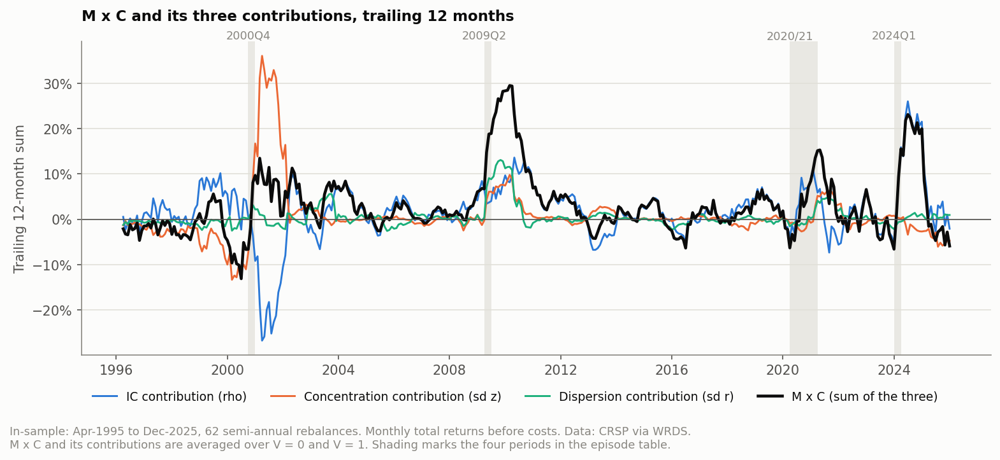

# Why does M x C exist? Covariance decomposition

Generated by `scripts/12_mxc_decomposition.py` with `scripts/mxc_decomposition.py`. For a base b and tilt score s, R_tilt - R_base = Cov_b(z, r) = rho_b x sd_b(z) x sd_b(r) with z = s / sum(b s). M x C is Cov under the cap base minus Cov under the base without cap, and an exact Shapley split over the six orderings gives the IC, concentration and dispersion contributions, which add up to M x C every month. This is an accounting identity: each part is a contribution from one factor, not a cause.

Tilt score s = max(momentum, 0) within the top quintile on momentum / sigma, 0 elsewhere. Section 3's M x C averages over V, so the decomposition is run on two slices and averaged: V = 0 (bases 010 and 000, tilts 110 and 100) and V = 1 (bases 011 and 001, tilts 111 and 101). sd(r) is the monthly cross-sectional standard deviation of returns.

## Validation

Maximum absolute monthly gap between the panel and the Section 3 portfolios, recomputed from raw data for every month since Apr-1975:

| Check | Max abs gap |
|---|---|
| V = 0: R_tilt_C vs 110 | 2.2e-16 |
| V = 0: R_base_C vs 010 | 2.8e-16 |
| V = 0: R_tilt_E vs 100 | 1.4e-16 |
| V = 0: R_base_E vs 000 | 2.8e-16 |
| V = 1: R_tilt_C vs 111 | 1.7e-16 |
| V = 1: R_base_C vs 011 | 1.9e-16 |
| V = 1: R_tilt_E vs 101 | 1.7e-16 |
| V = 1: R_base_E vs 001 | 1.9e-16 |
| M x C (average of slices) vs Section 3 formula | 2.3e-16 |

Against the published `output/attribution/monthly_returns.csv` (in-sample, rounded to 8 decimals): max abs gap 5.0e-09. Identity R_tilt - R_base = Cov and the Shapley sum hold to 1e-12 every month.

In-sample M x C (369 months): +2.84% a year, t = 2.84 (independent months), 2.39 (Newey-West, 6 lags). Section 3 reports +2.8%, 2.84 and 2.39.

## In-sample: Apr-1995 to Dec-2025 (369 months)

Mean contribution (% a year) and Newey-West t (6 lags).

|  | Mean | NW t | V = 0: mean (NW t) | V = 1: mean (NW t) |
|---|---|---|---|---|
| M x C | +2.84% | 2.39 | +3.02% (2.25) | +2.66% (2.54) |
| IC contribution (rho) | +1.88% | 1.61 | +2.03% (1.63) | +1.74% (1.55) |
| Concentration contribution (sd z) | +0.54% | 0.53 | +0.49% (0.46) | +0.60% (0.60) |
| Dispersion contribution (sd r) | +0.42% | 0.94 | +0.50% (0.99) | +0.33% (0.87) |

Average monthly levels of the moments under each base (C = with market cap, E = without).

|  | V = 0 C (010) | V = 0 E (000) | V = 1 C (011) | V = 1 E (001) |
|---|---|---|---|---|
| rho (IC) | +0.019 | +0.008 | +0.019 | +0.008 |
| sd(z) (concentration) | 2.21 | 2.53 | 2.13 | 2.39 |
| sd(r) (dispersion, monthly) | 7.00% | 8.15% | 6.49% | 7.38% |
| Effective N of the tilt | 26 | 71 | 26 | 84 |

Mean contribution (% a year) split by the sign of the IC (averaged over the four bases). Each column divides by all months of the sample, so the two columns add up to the total.

|  | Total | Months with IC < 0 (170) | Months with IC >= 0 (199) |
|---|---|---|---|
| M x C | +2.84% | +0.92% | +1.92% |
| IC contribution (rho) | +1.88% | -3.67% | +5.55% |
| Concentration contribution (sd z) | +0.54% | +2.75% | -2.21% |
| Dispersion contribution (sd r) | +0.42% | +1.84% | -1.42% |

## Out-of-sample (exploratory): Apr-1975 to Mar-1995 (240 months)

**Exploratory.** The holdout was already used once by `scripts/10_oos.py`; these numbers are a description, not a test.

Mean contribution (% a year) and Newey-West t (6 lags).

|  | Mean | NW t | V = 0: mean (NW t) | V = 1: mean (NW t) |
|---|---|---|---|---|
| M x C | -0.92% | -1.14 | -0.92% (-1.02) | -0.93% (-1.22) |
| IC contribution (rho) | +0.57% | 0.57 | +0.74% (0.71) | +0.41% (0.41) |
| Concentration contribution (sd z) | -0.77% | -1.89 | -0.80% (-1.83) | -0.74% (-1.95) |
| Dispersion contribution (sd r) | -0.72% | -1.79 | -0.85% (-1.92) | -0.59% (-1.60) |

Average monthly levels of the moments under each base (C = with market cap, E = without).

|  | V = 0 C (010) | V = 0 E (000) | V = 1 C (011) | V = 1 E (001) |
|---|---|---|---|---|
| rho (IC) | +0.022 | +0.018 | +0.022 | +0.019 |
| sd(z) (concentration) | 2.10 | 2.40 | 2.03 | 2.28 |
| sd(r) (dispersion, monthly) | 6.18% | 7.92% | 5.82% | 7.29% |
| Effective N of the tilt | 33 | 73 | 29 | 85 |

Mean contribution (% a year) split by the sign of the IC (averaged over the four bases). Each column divides by all months of the sample, so the two columns add up to the total.

|  | Total | Months with IC < 0 (94) | Months with IC >= 0 (146) |
|---|---|---|---|
| M x C | -0.92% | -0.69% | -0.24% |
| IC contribution (rho) | +0.57% | -3.46% | +4.03% |
| Concentration contribution (sd z) | -0.77% | +1.04% | -1.81% |
| Dispersion contribution (sd r) | -0.72% | +1.73% | -2.46% |

## Episodes (in-sample)

Sum of the monthly values over each window, M x C and its parts averaged over V. Too few months for t-stats.

| Period | Months | M x C | IC contribution (rho) | Concentration contribution (sd z) | Dispersion contribution (sd r) |
|---|---|---|---|---|---|
| 2000Q4 | 3 | +8.46% | -10.29% | +16.67% | +2.09% |
| 2009Q2 | 3 | +12.61% | +1.48% | +4.03% | +7.11% |
| Apr-2020 to Mar-2021 | 12 | +15.13% | +5.86% | +5.18% | +4.09% |
| 2024Q1 | 3 | +16.83% | +15.66% | -0.14% | +1.32% |

Average moments over each window, V = 0 slice (C = 010, E = 000).

| Period | rho C | rho E | sd(z) C | sd(z) E | sd(r) C | sd(r) E |
|---|---|---|---|---|---|---|
| 2000Q4 | -0.367 | -0.273 | 1.73 | 3.02 | 13.05% | 14.02% |
| 2009Q2 | -0.038 | -0.049 | 5.03 | 7.20 | 10.32% | 16.45% |
| Apr-2020 to Mar-2021 | -0.009 | -0.042 | 1.58 | 2.29 | 7.20% | 9.09% |
| 2024Q1 | +0.511 | +0.146 | 2.23 | 2.32 | 7.46% | 6.62% |

